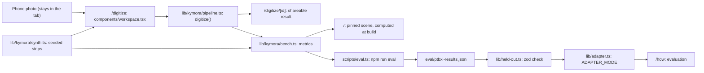

# Kymora

Kymora reads a phone photo of a printed lead II ECG rhythm strip in the browser, turns it into millivolts and milliseconds, and reports heart rate and RR intervals, or refuses when the photo cannot support a number. Millions of ECGs only exist on paper and still get measured by eye with a ruler, and patient images should not have to leave the device to become data.

> Live demo: https://kymora-eight.vercel.app. Click "Digitize an example strip" on the landing page (DEMO.md step 1).

The live URL runs with the default `ADAPTER_MODE=fake`, so `/how` says the deployment shows the synthetic bench and that the held-out PTB-XL table is not part of this build yet. Strip result pages are seeded synthetic strips in both modes, which is what gives them an exact reference. The digitizer itself is the real pipeline in both modes; only the held-out table needs the committed PTB-XL results file and `ADAPTER_MODE=real`.

## Try it in 60 seconds

1. Open https://kymora-eight.vercel.app and click "Digitize an example strip". The tilted seeded strip loads in `/digitize`, the green trace settles on the ink, and the calibration shows px/mm and the tilt.
2. Read heart rate and mean RR next to the reference value and the signed error, then click "Download CSV (mV, 250 Hz)".3. Pick "Motion-blurred phone photo". Kymora answers "No reliable measurement" with its quality score against the 0.60 gate and no number.
4. Open `/how`, run the synthetic bench in the browser, and click "Show baseline" and "Show Kymora" to compare the two methods.
5. Open `/digitize/sinus-72-tilted` and click "Copy result link". Every result has its own URL.

## How the pieces fit



## Addresses

| What | Where |
|---|---|
| Live web app | https://kymora-eight.vercel.app |

## The problem

Millions of ECGs only exist on paper or as scanned images. A GP at a rural health post photographs a rhythm strip and sends it over a messaging app, and the cardiologist on the other end measures it by eye with a ruler. A researcher with a cabinet of archived printouts can't run any signal analysis on them.

The George B. Moody PhysioNet Challenge 2024 was devoted entirely to digitizing ECG images, so this is a known gap. The open tools we found come as Python pipelines, MATLAB code or desktop downloads, and the web tools we found upload the image to a server.

## The solution

A pure TypeScript module (`lib/kymora/pipeline.ts`) reads the image from a canvas and runs one function per stage:

1. **Masks.** Each pixel gets a luminance and a redness value (r minus the mean of g and b). Pixels pinker than the paper count as grid. Dark pixels that aren't pink count as ink.
2. **Tilt** (`estimateSkew`). The grid mask is projected at every angle from -8° to +8° in 0.25° steps, then again in 0.02° steps around the best one. The angle that gives the sharpest row profile is the tilt. The fine pass matters: a 0.1° miss smears the 1 mm lines by several pixels across a 2000 px strip and drags the grid score under the gate.
3. **Scale** (`gridPeriod`). Autocorrelating the deskewed grid profile finds the 1 mm line spacing, and the 5 mm box spacing refines it. Together they give pixels per millimetre, so the paper acts as its own ruler at 25 mm/s and 10 mm/mV.
4. **Trace** (`extractTrace`, `traceToSignal`). With the grid masked out, the ink centroid of each column becomes one sample. The trace is converted to mV and resampled to 250 Hz.
5. **Beats** (`detectRPeaks`). A Pan-Tompkins style QRS detector (band-pass, derivative, squaring, 150 ms integration, adaptive thresholds, refractory period, T-wave rejection, search-back) finds the R peaks. Heart rate is 60000 divided by the mean RR.
6. **Quality gate.** Quality is 0.55 × grid score + 0.45 × trace continuity. If it falls below 0.6, the app shows the reasons and no number. The same happens with fewer than three beats, a non-square grid, less than 4 s of trace, or a rate outside 25 to 220 bpm.

The photo never leaves the device. There is no server route that accepts images.

**Who it is for:** clinicians who share strips as photos, and researchers digitizing paper archives. **What it is not:** a diagnostic device. It measures rhythm on one lead and nothing else.

## Evaluation

**Metrics, in clinical units**

| Metric | How it is measured |
|---|---|
| HR MAE (bpm) | absolute difference between reported and reference heart rate |
| RR MAE (ms) | each detected RR interval vs the reference interval starting at the nearest true R peak (within 150 ms) |
| SNR (dB) | 10 log10(Σref² / Σ(ref − est)²), means removed, best lag within ±60 ms. This is the PhysioNet Challenge 2024 digitization metric |
| Rejection rate | share of strips where the quality gate withheld a result |

**Comparison.** The baseline assumes a 300 DPI scan (11.81 px/mm), takes the darkest pixel in each column, skips deskewing and has no quality gate. The baseline is also scored on just the strips Kymora accepted, so the comparison isn't flattered by rejections.

**Layer 1, synthetic bench (runs today).** `lib/kymora/synth.ts` draws seeded strips: a Gaussian P-QRS-T beat model on a pink 1 mm / 5 mm grid, plus tilt (±5°), scale (4.5 to 9 px/mm), box blur, shadow and sensor noise. The truth is exact because we generated it. With seed 42, about a quarter of the strips are degraded on purpose. You can run the same bench in the browser on `/how`, or from the command line:

```bash
npm run eval                          # seed 42, 200 strips, writes eval/results.json
npm run eval -- --seed 7 --n 500      # any other seed or size
```

The output table and `eval/results.json` include the full `CONFIG` object (every threshold the pipeline uses). `npm run proof` reruns a 60 strip version (seed 42) and writes the table into the block below:

<!-- PROOF:BEGIN eval-synthetic -->
Command: `npm run eval -- --seed 42 --n 60 --out eval/proof-synthetic.json`

```text
Kymora synthetic bench: seed 42, 60 strips

method                                     n   HR MAE (bpm)  RR MAE (ms)  SNR (dB)  rejected
-----------------------------------------  --  ------------  -----------  --------  --------
Kymora (grid calibration + quality gate)   5   0.14          1.2          12.88     91.7%   
Baseline (300 DPI assumed, darkest pixel)  59  39.44         277.5        -3.20     1.7%    
Baseline on the strips Kymora accepted     5   33.44         153.3        -4.42     0.0%    

config: {"maxSkewDeg":8,"skewStepDeg":0.25,"skewFineStepDeg":0.02,"minPxPerMm":3,"maxPxPerMm":40,"gridRedMargin":6,"inkLumRatio":0.6,"inkRedMargin":25,"minColumnMass":15,"fs":250,"qualityThreshold":0.6,"minDurationS":4,"minHeartRate":25,"maxHeartRate":220}
```
<!-- PROOF:END eval-synthetic -->

**Layer 2, held-out clinical set.** This uses PTB-XL fold 10, the test fold recommended by the dataset authors. `scripts/ptbxl/make_set.py` takes the first 300 fold 10 records by `ecg_id`, reads lead II at 500 Hz with `wfdb`, and detects reference R peaks on the source signal (`wfdb.processing.xqrs_detect`). It renders each record as a paper strip image with ECG-Image-Kit (or, as the documented fallback, a small seeded matplotlib renderer), then applies the same seeded tilt, blur, shadow and JPEG degradations from the committed `scripts/ptbxl/render-config.json`. The manifest records the renderer, the seed and, per image, `traceStartS` (where the trace starts on the image). `npm run eval -- --set ptbxl` decodes each PNG with `pngjs`, scores it with `evaluateRaster()` in `lib/kymora/bench.ts` (the same scoring code as the synthetic bench) and writes `eval/ptbxl-results.json`. The `/how` page reads that committed file through a zod schema when `ADAPTER_MODE=real`. Fold 10 is never used for tuning. Results from real phone photos of printed PTB-XL strips will go in a separate small table, because they will be worse than these numbers.

<!-- PROOF:BEGIN eval-ptbxl -->
Not run in this build: data/ptbxl-fold10 has not been generated (needs Python, wfdb and a local PTB-XL copy).
<!-- PROOF:END eval-ptbxl -->

**Tests.** `npm test` runs the scoring, schema and adapter tests in `tests/` with `node:test`.

<!-- PROOF:BEGIN tests -->
```text
npm test: 21 tests, 21 passed, 0 failed (4 files, node:test via tsx)
```
<!-- PROOF:END tests -->

## Who benefits, and who could be harmed

**Benefits:** clinicians far from a cardiologist, who today get strips measured by eye. Researchers with paper ECG archives. Indirectly, patients whose old printouts become comparable with new recordings.

**Harm:** a patient with bradycardia, if a wrong calibration reports 60 bpm for a true 40 and the slow rate gets missed. The gate rejects implausible scales for this reason, and the bench reports HR error with its sign. A second risk is strips that don't look like our test images: grey grids, no grid, or 50 mm/s paper speed. Kymora assumes 25 mm/s and 10 mm/mV, so a 50 mm/s strip would read at half its true rate.

## Limitations

- Lead II rhythm strips only. Crop a 12-lead page before using it.
- Grid detection relies on colour, so black-and-white copies get rejected.
- Tilt is corrected. Perspective is only detected (non-square grid) and then rejected.
- The synthetic strips are cleaner than real photos.
- Kymora reports heart rate and RR only. It gives no rhythm labels, QT, or diagnosis.

## With one more month

Perspective correction from the four corners of the grid. A learned trace extractor for overlapping leads, compared against the current centroid method on the same held-out set. A full 12-lead layout parser. And a small reader study where clinicians compare Kymora's RR values with their own ruler measurements.

## Tech stack

Next.js 15 (App Router), React 19, TypeScript 5 (strict), Tailwind CSS 4, shadcn-style primitives, GSAP 3 with ScrollTrigger and `@gsap/react` (the pinned scene and the headline intro on the landing page, and the Kymora against baseline figure tween on `/how`; all three are skipped under reduced motion), hand-drawn SVG charts (no chart library), zod 3 (validation at every data edge), pngjs 7 (eval only, decodes the held-out images), HTML canvas ImageData, tsx for `npm run eval`, `npm run seed` and `npm test`. Deployed as a Vercel site. The held-out set builder needs Python with `wfdb`, numpy, matplotlib and Pillow (`scripts/ptbxl/requirements.txt`), plus ECG-Image-Kit for the default renderer, but the web app doesn't.

There are no machine-learning models in the app. Everything is signal processing.

## Prize categories

All four categories are judged automatically from the same submission. Step numbers refer to `DEMO.md`.

| Bounty | Prize | Slots | Required tech | Code file | DEMO step |
|---|---|---|---|---|---|
| Grand Prize | A signed PDF certificate of achievement for the highest combined score across the four published judging criteria. No cash value. | 1 | none | `lib/kymora/pipeline.ts`, `scripts/eval.ts` | 2 to 6 |
| Excellence in Research & Reproducibility | A signed PDF certificate of achievement for strong evaluation, appropriate comparisons, transparent limitations, and reproducible results. No cash value. | not stated | none | `scripts/eval.ts`, `scripts/ptbxl/make_set.py`, `components/held-out-panel.tsx` | 5 and 6 |
| Best Presentation | A signed PDF certificate of achievement for the clearest explanation of the project, its working features, and its results. No cash value. | not stated | none | `components/result-view.tsx`, `app/digitize/[id]/page.tsx` | 2 to 7 |
| Best Logo | A signed PDF certificate of achievement for the strongest project logo, judged on originality, clarity, and relevance to the project. No cash value. | not stated | none | `public/logo.svg`, `components/brand-mark.tsx` | 1 and 7 |

Delivery notes per category are in `DELIVERY.md`. Data handling and the (empty) wallet and contract surface are in `SECURITY.md`.

## Quickstart

```bash
npm install
npm run dev        # http://localhost:3000
npm run eval       # reproduce the evaluation table
npm test           # scoring, schema and adapter tests (node:test via tsx)
npm run proof      # rerun the proofs and rewrite the PROOF blocks in this README
```

`npm run seed` lists the 12 seeded strips and their reference heart rate; `npm run demo:reset` is covered below.

No secrets or API keys are needed. One optional variable, `ADAPTER_MODE` (default `fake`, the seeded synthetic strips), selects the data source behind `lib/adapter.ts`. `real` serves the committed held-out results when `eval/ptbxl-results.json` is valid, otherwise the app stays on fake. See `.env.example`.

Routes: `/` story, `/digitize` workspace, `/digitize/<strip-id>` shareable result, `/how` method and evaluation.

## Reset and walk the demo

```bash
npm run demo:reset   # print the seed, rerun the two demo strips 3 times each, check accept and refuse
npm run lookup       # after the held-out set exists: write eval/ptbxl-lookup.json from the manifest
```

`npm run demo:reset` writes nothing. It lists the 12 seeded strips, runs the featured strip and `blurred-75-motion` three times each and requires identical results (runtime excluded), checks that the featured strip is accepted and the blurred one is refused below the 0.60 quality gate, and reports whether `eval/ptbxl-results.json` and `eval/ptbxl-lookup.json` load or which reason code says why not. It exits 1 on any failed check.

There is no database, so there is no migration or schema push. There is no server state to clear either: a dropped photo's result lives only in the tab's `sessionStorage`, so a private window is the clean start for a walk through `DEMO.md`.

`npm run lookup` reads `data/ptbxl-fold10/manifest.json` and writes the compact ecg_id to reference lookup. Without a manifest it prints one line and writes nothing. With the lookup committed and `ADAPTER_MODE=real`, a dropped PTB-XL photo named after its ecg_id (`00009.png`, `ecg_00009_photo.jpeg`) shows "PTB-XL fold 10 reference, ecg_id 9" and the signed error beside the measured rate. Phone camera names such as `IMG_20241103.jpg` never match.

<!-- PROOF:BEGIN demo-reset -->
```text
npm run demo:reset: 6 checks, 1 failed

ok   sinus-72-tilted: 3 runs give identical results
ok   blurred-75-motion: 3 runs give identical results
FAIL sinus-72-tilted: accepted, no bpm, mean RR none ms
ok   blurred-75-motion: refused, quality 0.44 against the 0.6 gate
ok   held-out results: not loaded, reason=not_configured
ok   ptbxl lookup: not loaded, reason=not_configured
```
<!-- PROOF:END demo-reset -->

The block above is rewritten on every proof run and is the current state. An earlier run failed the featured-strip check: the coarse 0.25° tilt search missed by about 0.1°, the leftover tilt smeared the 1 mm horizontal grid lines and the strip fell under the quality gate. `estimateSkew` now adds a 0.02° pass; no gate or threshold in `CONFIG` was changed. The landing scene still uses the featured strip only when it has a rate, and otherwise the most tilted seeded strip that does.

## Held-out set

You need Python 3, a local PTB-XL copy from PhysioNet (about 2 GB on disk) and, for the default renderer, a local clone of ECG-Image-Kit. The script never downloads anything.

```bash
pip install -r scripts/ptbxl/requirements.txt
python scripts/ptbxl/make_set.py --ptbxl-root <path> --renderer ecgkit --ecgkit-dir <ecg-image-kit clone>
# fallback without ECG-Image-Kit: python scripts/ptbxl/make_set.py --ptbxl-root <path> --renderer matplotlib
npm run eval -- --set ptbxl
```

This writes `data/ptbxl-fold10/manifest.json`, `data/ptbxl-fold10/reference/*.json` (lead II in mV at 100 Hz), the images in `data/ptbxl-fold10/images/` (gitignored) and `eval/ptbxl-results.json`. The manifest, the reference files and the results file are committed. The default seed is 42. The ECG-Image-Kit command line flags and the rhythm strip crop in `render-config.json` follow its README and have not been verified by a run yet.

## Attribution

- Pan J, Tompkins WJ. A real-time QRS detection algorithm. IEEE Trans Biomed Eng. 1985;32(3):230-236. Our detector is our own TypeScript adaptation of the method.
- Wagner P, Strodthoff N, et al. PTB-XL, a large publicly available electrocardiography dataset. Scientific Data 7, 154 (2020). Distributed by PhysioNet (check the license on the PhysioNet page before redistributing derived images).
- Shivashankara KK, et al. ECG-Image-Kit: a synthetic image generation toolbox to facilitate deep learning-based electrocardiogram digitization. Physiological Measurement (2024).
- Goldberger A, et al. PhysioBank, PhysioToolkit, and PhysioNet. Circulation 101(23) (2000).
- The George B. Moody PhysioNet Challenge 2024 (ECG image digitization and classification) for the SNR metric definition.

## AI use

The hackathon rules allow AI assistants and generators and ask entrants to disclose which tools did what; one line is enough. Ours: Claude Code (Anthropic) drafted the Next.js scaffold, the pipeline functions, the PTB-XL set builder, the eval loader, the tests, the SVG illustrations and this README, and we reviewed, tested and edited all of it; no AI model runs inside Kymora itself.

## License

No license file is committed yet, so default copyright applies until the team adds one. Third-party datasets and methods keep their own licenses (see Attribution).
